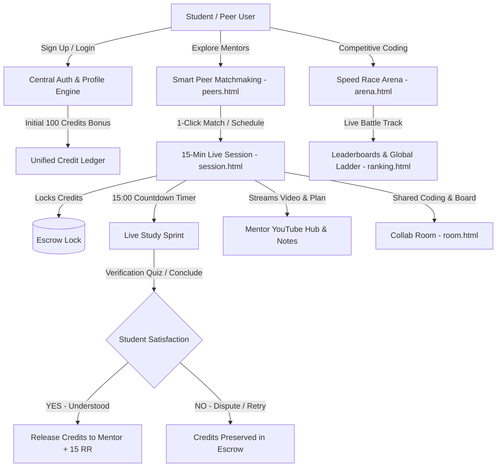

# 🌟 GyanSetu (ज्ञान सेतु)
### *Decentralized Campus Peer-to-Peer Learning & Skill Escrow Platform*

[](http://gyan-setu-six.vercel.app/)
[](https://supabase.com/)
[](https://tailwindcss.com/)
[](http://gyan-setu-six.vercel.app/)
[](http://gyan-setu-six.vercel.app/)

---

## 🔗 Live Application Links

- 🌐 **Production Demo:** [http://gyan-setu-six.vercel.app/](http://gyan-setu-six.vercel.app/)
- 🎯 **Speed Race Arena:** [http://gyan-setu-six.vercel.app/arena.html](http://gyan-setu-six.vercel.app/arena.html)
- 🤝 **Peer Matching & Mentors:** [http://gyan-setu-six.vercel.app/peers.html](http://gyan-setu-six.vercel.app/peers.html)
- ⏱️ **15-Min Live Session Booking:** [http://gyan-setu-six.vercel.app/session.html](http://gyan-setu-six.vercel.app/session.html)
- 🏆 **Campus Leaderboard & RR Ranking:** [http://gyan-setu-six.vercel.app/ranking.html](http://gyan-setu-six.vercel.app/ranking.html)
- 📊 **Unified Student Dashboard:** [http://gyan-setu-six.vercel.app/dashboard.html](http://gyan-setu-six.vercel.app/dashboard.html)

---

## 📌 Executive Summary & Problem Statement

### ❌ The Campus Dilemma
In modern universities, students often encounter academic roadblocks in **Data Structures, Web Development, Competitive Programming, and Core Engineering**. 
- Professional 1-on-1 tutors are unaffordable for college students.
- Discussion forums (Discord, Reddit, WhatsApp) are noisy, unorganized, and delayed.
- Knowledgeable senior peers lack incentives or structured mediums to mentor juniors.

### 💡 The GyanSetu Solution
**GyanSetu** is a decentralized, gamified peer-to-peer knowledge exchange and escrow economy:
1. **Zero-Risk Escrow System:** When booking a mentorship session, credits are locked safely in escrow and **move only after the session concludes and the learner confirms satisfaction**.
2. **15-Minute Live Focused Sprints:** High-yield micro-learning sessions equipped with a live countdown clock, synced YouTube video lectures, and live study notes.
3. **Speed Race Arena:** Real-time competitive coding and aptitude duel arena where peers battle head-to-head on live progress tracks.
4. **Smart Matchmaking Engine:** Automatic algorithm pairing peers based on topic (DSA, React, System Design, SQL), programming language, and campus availability.
5. **Gamified Reputation (RR & XP):** Transparent ranking rating (RR), rank protection shields, and daily streaks that incentivize genuine peer assistance.

---

## 🚀 Key Modules & Architecture



---

## 🎯 Deep Dive: Core Features

### 1. ⏱️ 15-Minute Live Session Booking & Escrow (`session.html`)
- **Strict Credit Escrow Guarantee:** Credits offered are held securely during the session. They are transferred to the mentor **only after** completion and verification.
- **Synchronized 15:00 Countdown Clock:** Real-time synchronized clock displaying elapsed/remaining time with visual progress bars and completion pulses.
- **Mentor Timer Controls:** Mentors can extend sessions by `+5 Mins` or conclude early.
- **Mentor YouTube Video & Resource Hub:** Mentors can embed any YouTube tutorial/walkthrough URL and share study notes. The embedded 16:9 player streams live to the learner's screen in real time.
- **Post-Session Student Satisfaction:** Learner confirms understanding (`YES, Understood!` releases escrow & awards **+15 RR**; `NO, Need Help` freezes funds with dispute resolution options).

### 2. 🏁 Speed Race Arena (`arena.html`)
- **Esports-Inspired Duel UI:** Dark obsidian carbon theme with toxic lime and emerald accents (`#0B1F17`, `#B9F044`, `#10B981`) and ruby rival indicators.
- **Auto-Scroll to Battle Station:** Clicking *"Launch Match 🏁"* smoothly brings racers directly to the live dual track and question paper.
- **Dynamic Question Engine:** Dual modes supporting coding challenges (with in-browser code editor & test runner) and aptitude quizzes (MCQ selection with live feedback).

### 3. ⚡ Smart Peer Matching (`peers.html`)
- **"⚡ Smart Match & Pair Me" Modal:** Instant algorithm pairing students with suitable active campus peers based on topic, language, and skill level.
- **Active Study Partner Status Card:** Persistent floating HUD showing the current partner with 1-click room and session launchers.
- **Topic & Language Categorization:** Quick filter chips for DSA, Web Dev, Python, System Design, SQL, and extra custom skills.

### 4. 🏆 Campus Leaderboard & RR Rating (`ranking.html`)
- **Fair ELO-Style Reputation (RR):** Tracks genuine learning contributions rather than arbitrary numbers.
- **Rank Protection:** Prevents rating decay due to occasional connection issues.
- **Campus & Branch Filters:** View leaderboards filtered by college, department, and academic year.

### 5. 💳 Unified Credit Economy & Ledger (`dashboard.html`)
- **100 Starter Credits:** Every student receives a 100-credit bonus upon joining.
- **Immutable Transaction History:** All credit transfers, rewards, challenge winnings, and refunds are logged in the `credit_ledger` table.

---

## 🛠️ Technology Stack

| Layer | Technology | Purpose |
| :--- | :--- | :--- |
| **Frontend UI** | HTML5, Tailwind CSS 3, Lucide Icons | Responsive, high-performance UI across desktop & mobile |
| **Styling & Theme** | Custom Tailwind Palette (`#0B1F17`, `#B9F044`, `#2F6F11`) | Ultra-gaming esports aesthetic meets clean campus green |
| **Client Logic** | Modern ES6+ JavaScript | Zero external build dependencies, instant page load |
| **Database & Auth** | Supabase (PostgreSQL 15 + GoTrue Auth) | Persistent user profiles, credit ledgers, and session records |
| **Realtime Engine** | Supabase Realtime + `BroadcastChannel` API | Multi-channel cross-network and cross-tab peer synchronization |
| **Media & Collab** | YouTube No-Cookie Embed API, WebRTC Canvas | Low-latency video lecture embedding & collaborative whiteboard |
| **Hosting & CI/CD** | Vercel Serverless Edge | Instant global CDN delivery with automatic deployments |

---

## 📱 Mobile Responsiveness Highlights

The entire application is optimized for mobile screens down to $320\text{px}$:
- **Auto-Zoom Prevention:** Form inputs maintain a `16px` font size to stop mobile browsers from zooming on tap.
- **Thumb-Friendly Touch Targets:** Minimum $44\text{px}$–$48\text{px}$ touch zones on all buttons, quiz choices, and preset chips.
- **Segmented Control Adaptability:** 3-column credit preset selectors stack cleanly on narrow phones without squeezing number inputs.
- **No-Scrollbar Horizontal Sliders:** Quick topic and preset pills slide smoothly with native momentum scrolling (`no-scrollbar`).
- **Safe Area Bottom Padding:** Generous `pb-16` padding prevents bottom mobile browser navigation bars from obscuring action buttons.

---

## 📂 Project Structure

```
Gyan-Setu/
├── index.html               # Landing page, value proposition & portal navigation
├── dashboard.html           # Unified student command center & credit ledger
├── arena.html               # Esports Speed Race coding & aptitude battle arena
├── peers.html               # Smart peer matching, mentor catalog & study partner card
├── session.html             # 15-Minute Live Session, timer, YouTube hub & escrow system
├── ranking.html             # Campus leaderboard, department filters & RR rank ladder
├── room.html                # Live collaborative code editor & whiteboard canvas
├── login.html               # Central authentication with 1-click confirmation bypass
├── vercel.json              # Vercel deployment & routing configuration
├── supabase_setup.sql       # Complete database schema, RLS policies & ledger triggers
├── SUPABASE_SETUP_GUIDE.md  # 2-minute Supabase database initialization guide
├── README.md                # Comprehensive project documentation
├── css/
│   └── style.css            # Custom animations, scrollbar utilities & glowing effects
├── js/
│   ├── gyansetu-auth.js     # Unified Supabase authentication & profile state controller
│   ├── session.js           # 15-Min timer engine, YouTube sync & escrow release logic
│   ├── question-engine.js   # Dynamic coding challenges & aptitude test question engine
│   ├── peers.js             # Smart peer matchmaker, filter algorithms & partner HUD
│   ├── room.js              # Real-time whiteboard & collaborative code editor engine
│   ├── gyansetu-network.js  # Peer presence & WebRTC network communication layer
│   ├── credits-config.js    # Credit pricing, escrow limits & transaction constants
│   ├── rr-config.js         # Reputation rating (RR) calculations & streak rewards
│   └── supabase-config.js   # Supabase client credentials & project endpoint
```

---

## ⚡ Quick Start / Local Installation

### Prerequisites
- Any modern web browser (Google Chrome, Firefox, Safari, Microsoft Edge).
- Optional: Node.js (for local static server testing).

### Option 1: Live Demo (No Setup Needed)
Simply open the production deployment in your browser:
👉 **[http://gyan-setu-six.vercel.app/](http://gyan-setu-six.vercel.app/)**

### Option 2: Run Locally
1. **Clone the repository:**
   ```bash
   git clone https://github.com/rahul/Gyan-Setu.git
   cd Gyan-Setu
   ```

2. **Serve with any static file server:**
   - Using Node.js:
     ```bash
     npx serve .
     ```
   - Using Python 3:
     ```bash
     python -m http.server 8080
     ```
   - Using VS Code: Right-click `index.html` and click **"Open with Live Server"**.

3. **Open in browser:**
   Navigate to `http://localhost:8080` (or `http://localhost:3000`).

---

## 🧪 Testing & Verification Guide (For Hackathon Judges)

To test the complete end-to-end flow in 2 minutes:

1. **Step 1: Open Two Tabs (Peer Simulation)**
   - **Tab A (Learner):** Open `session.html`. Enter your name *"Aarav"* and select role **Learner**.
   - **Tab B (Mentor):** Open `session.html` in an Incognito window or second tab. Enter name *"Priya Sharma"* and select role **Mentor**.

2. **Step 2: Request a Session**
   - In Tab A, type Mentor: `Priya Sharma`, Topic: `Binary Trees in DSA`, Credits: `15`.
   - Click **"Request 15-Min Live Session"**.
   - Notice: Credits are protected in escrow and **not** deducted yet!

3. **Step 3: Accept in Real Time**
   - Switch to Tab B (Priya). The request appears instantly in the incoming list.
   - Click **"Accept & Launch 15-Min Session ✓"**.

4. **Step 4: Live 15-Minute Sprint & YouTube Lecture Hub**
   - Both tabs immediately synchronize with an active **15:00 countdown clock**!
   - In Tab B (Mentor), click the **"🌳 Binary Trees (15m)"** preset button. The YouTube link, notes, and plan populate automatically.
   - Click **"Publish & Sync Resources to Learner"**.
   - Tab A (Learner) immediately embeds the responsive YouTube video lecture and displays the study notes!

5. **Step 5: Completion & Escrow Transfer**
   - In Tab B, click **"1-Click Topic Quiz"** &rarr; **"Send Quiz to Learner"**.
   - In Tab A, answer the verification questions and click **"Submit Answers"**.
   - In Tab B, click **"Mark Session Complete & Release Credits"**.
   - **Result:** Credits move securely from Aarav to Priya, transactions are recorded in `credit_ledger` and `credit_log`, and student satisfaction confirmation is logged!

---

## 🏆 Hackathon Value Checklist

- [x] **End-to-End Functionality:** No mockup/placeholder screens; all booking, timer, video, and credit transfers work in real time.
- [x] **Zero-Risk Escrow Innovation:** Solves the trust barrier in campus barters by locking funds until satisfaction.
- [x] **Micro-Learning Optimization:** 15-minute timebox prevents burnout and guarantees focused knowledge sprints.
- [x] **Multi-Channel Fallback:** Works across disparate networks via Supabase Realtime and across browser tabs via `BroadcastChannel`.
- [x] **100% Mobile Responsive:** Optimized typography, touch targets, and responsive 16:9 media scaling on all devices.

---

## 👥 Contributors & Acknowledgements

- **Team GyanSetu** — Built with ❤️ for college students and peer learners.
- Powered by **Supabase**, **Vercel**, and **Tailwind CSS**.

---
*GyanSetu: ज्ञानं परमं बलम् — Knowledge is the Supreme Strength.*
